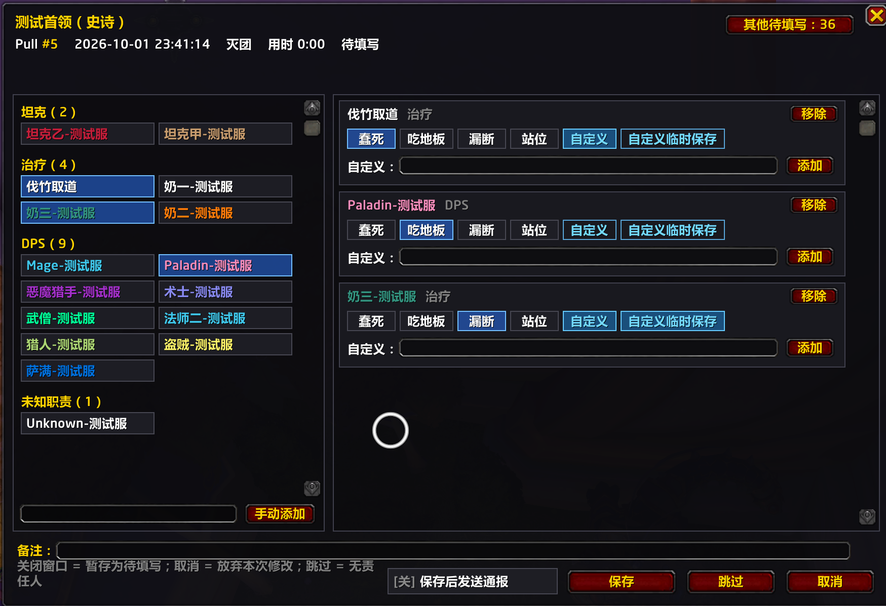
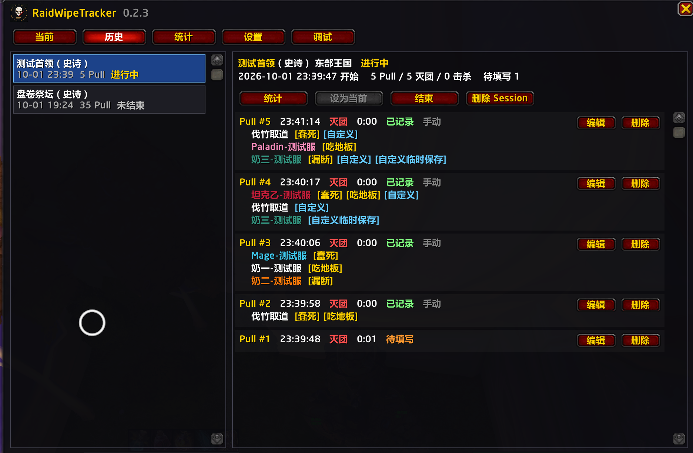
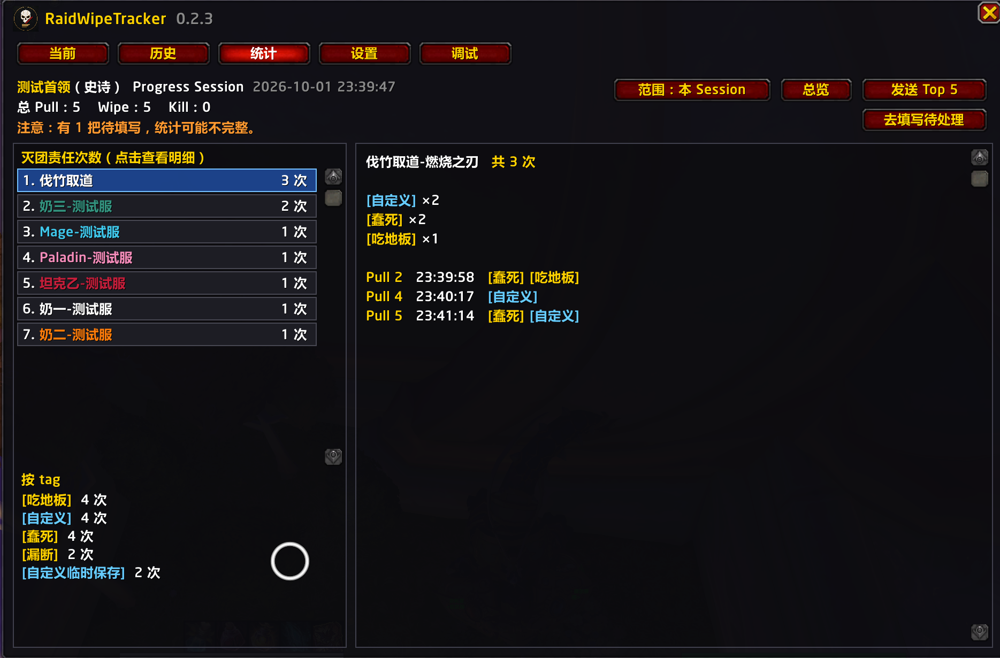
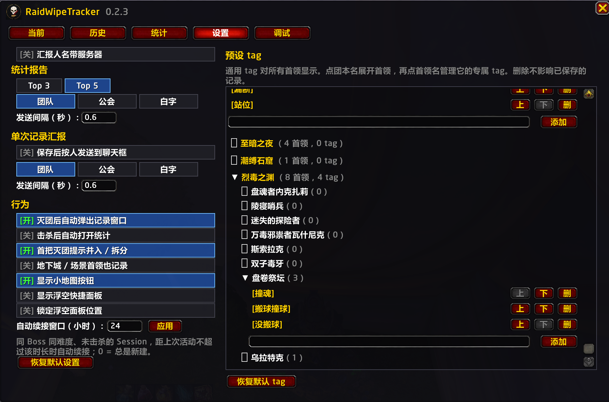

# RaidWipeTracker

Manual raid wipe attribution for World of Warcraft. 团本开荒时标记灭团责任人，按首领统计并通报团队。

正式服插件，界面为中文。灭团后手动记下责任人和原因，按首领累计次数，并可以把统计发到团队频道。作者：伐竹取道。

## 功能

- 灭团后弹出记录窗口，给团员打标签。击杀不计入责任统计。
- 预设标签可自行增删，也可以为单个首领设置专属标签。默认有「蠢死」「吃地板」「漏断」「站位」。
- 同一首领、同一难度会归到一场开荒里。默认 12 小时内自动续接，首把灭团时可以选择并入或拆分。
- 统计可以看本场，也可以看该首领的累计责任次数。
- 一键把排行发到团队、公会或说频道。保存记录后也可以按人通报。
- 小地图按钮、插件收纳按钮，以及一个可选手动记录的浮空面板。

## 环境

- 魔兽世界正式服，`Interface: 120100`（12.1.0）
- 默认只记录团队副本。五人本和场景战役需要在设置里单独打开。

## 安装

把 `RaidWipeTracker` 文件夹放到：

```
World of Warcraft\_retail_\Interface\AddOns\RaidWipeTracker
```

文件夹名必须是 `RaidWipeTracker`。进游戏后用 `/reload` 加载。

## 使用

开怪后插件会记下这一把。灭团脱战后弹出窗口，点选责任人并打上标签，然后保存。击杀后可以自动打开统计。`/rwt` 打开或关闭主窗口。

| 命令 | 作用 |
| --- | --- |
| `/rwt` | 打开或关闭主窗口 |
| `/rwt help` | 显示命令帮助 |
| `/rwt pending` | 打开下一个待填写的 Pull |
| `/rwt history` | 打开历史记录 |
| `/rwt stats` | 打开统计 |
| `/rwt report` | 把当前或最近一场的统计发到聊天频道 |
| `/rwt settings` | 打开插件内设置 |
| `/rwt config` | 打开 ESC、选项、插件中的设置页 |
| `/rwt new` | 下一次开怪强制新建一场 |
| `/rwt resume` | 续接最近一个未结束的场次 |
| `/rwt end` | 手动结束当前场次 |
| `/rwt minimap` | 显示或隐藏小地图按钮 |
| `/rwt panel` | 显示或隐藏浮空快捷面板 |
| `/rwt status` | 打印数据库里的场次和 Pull 数量 |
| `/rwt debug` | 模拟首领战，仅供测试。子命令：`start`、`wipe`、`kill`、`roster`、`off` |

小地图按钮：左键打开主面板，Shift+左键填写下一条待处理记录，右键开关浮空面板。拖动可以改位置。

## 界面









游戏内图标是 `RaidWipeTracker/Media/logo.tga`。CurseForge 项目 Logo 的源图是 `assets/curseforge-icon.png`，客户端不读取 PNG。

## 许可

版权所有 © 2026 伐竹取道。可以在自己的客户端里安装和使用，也可以为个人使用修改本地副本。未经书面许可，禁止去掉作者信息后传播，也禁止以自己的名义或通过整合包、插件站、公开仓库再分发。完整条款见 [RaidWipeTracker/LICENSE](RaidWipeTracker/LICENSE)。
